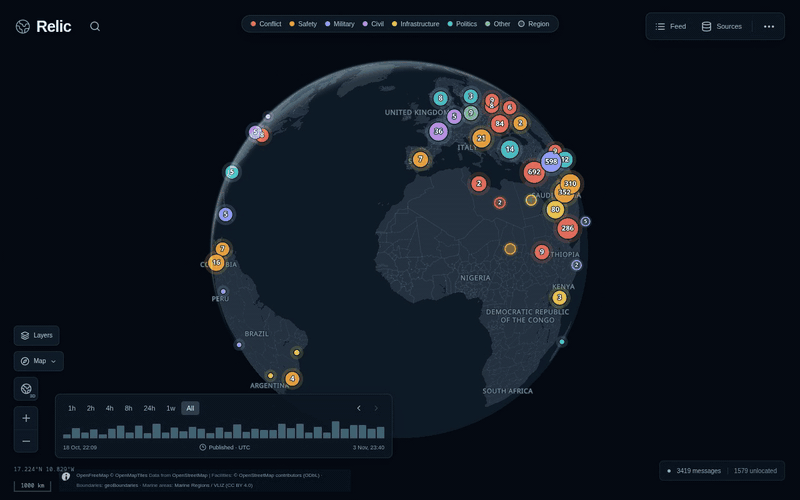
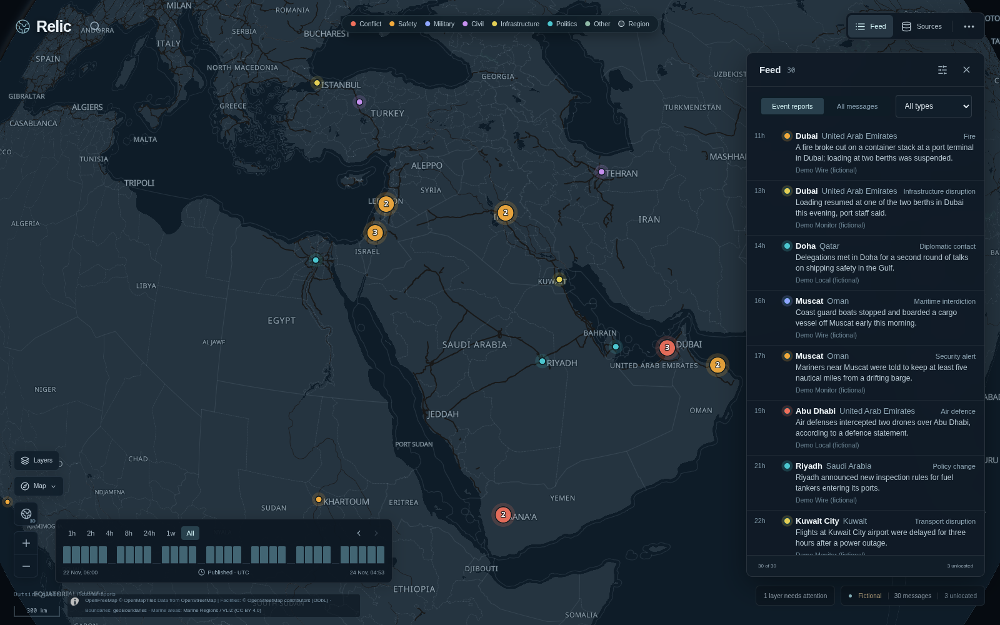
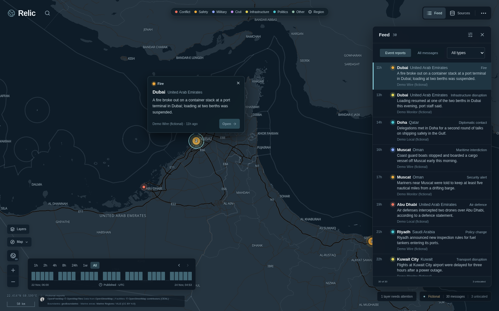
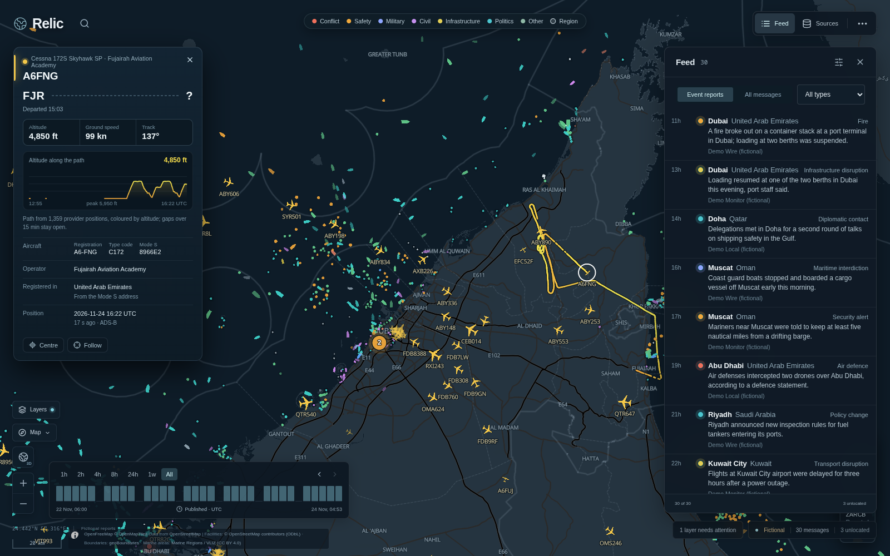
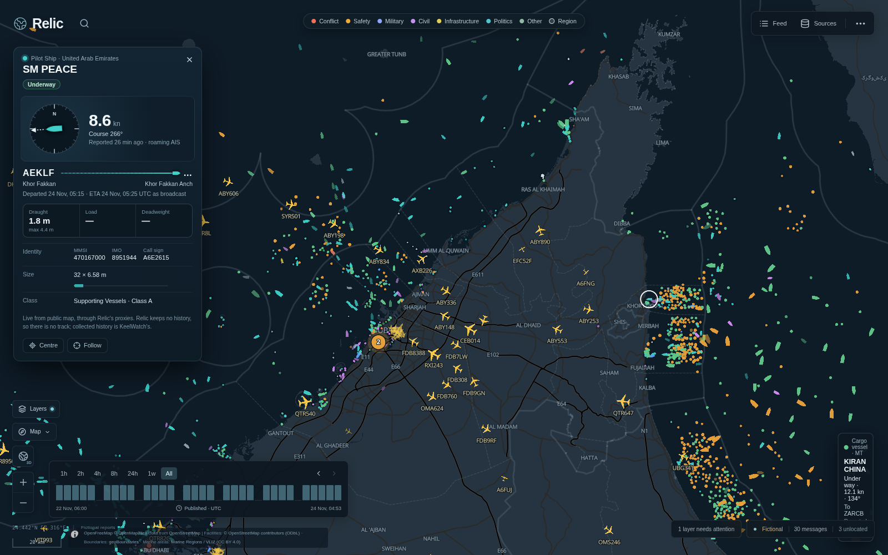

<h1 align="center">Relic</h1>

<p align="center">
  <b>A live map of what the world is reporting.</b><br/>
  Relic follows Telegram channels and other sources, reads every message with an LLM,<br/>
  and places what happened on a map beside live ships and aircraft, without inventing a single coordinate.
</p>

<p align="center">
  
  
  
  
  
</p>

<p align="center">
  
</p>

<p align="center"><sub>Demo workspace: the reports are fictional (<code>examples/demo-workspace.json</code>); aircraft and ships are live.</sub></p>

## What it does

- **Watches sources continuously.** Telegram is built in; X and other providers plug in as adapters. After downtime, each source catches up exactly from its last saved post, and any gap it cannot prove complete is recorded as a gap.
- **Reads every message.** An LLM translates it and extracts events, claims and places in strict JSON, which Rust then checks against the original text. Arabic, Hebrew, Persian and mixed-language posts are read as easily as English. The exact original is always one click away.
- **Puts it on the map, honestly.** Places resolve against GeoNames, Natural Earth, OpenStreetMap and marine-region data. If a place is ambiguous, the message stays in the feed **unlocated** instead of being dropped on a guessed point.
- **Groups reports of the same event.** Updates, denials and corrections are linked to what they update, deny or correct, and a repost never counts as a second confirmation.
- **Shows the physical picture.** Live aircraft and ships, ship history and "ships near this report" sit in the same view and the same time window.
- **Keeps provenance.** Every message opens to its source, revision and processing record. Edits keep the earlier version, and old views reopen exactly as they were.

<table>
  <tr>
    <td></td>
    <td></td>
  </tr>
  <tr>
    <td align="center"><sub>Reports placed on the map, with the feed</sub></td>
    <td align="center"><sub>A report opened where it happened</sub></td>
  </tr>
  <tr>
    <td></td>
    <td></td>
  </tr>
  <tr>
    <td align="center"><sub>Live aircraft: route, altitude profile, registration</sub></td>
    <td align="center"><sub>Live ships: course, speed, destination, identity</sub></td>
  </tr>
</table>

## Stack

| | |
| --- | --- |
| Backend | Rust, Tokio, Axum |
| Storage | SQLite + content-addressed files |
| Frontend | React, TypeScript, Vite, MapLibre GL |
| AI | OpenRouter (LLM reading, embeddings) |
| Sources | Telegram (MTProto), pluggable adapters |

How it fits together: [docs/ARCHITECTURE.md](docs/ARCHITECTURE.md). Evaluations and measurements: [docs/RESULTS.md](docs/RESULTS.md).

## Run it

Requirements: Rust 1.98 (selected automatically by `rust-toolchain.toml`), Node 22+, and a C toolchain for SQLite.

```sh
make build                                     # web app + release binary
cargo run --manifest-path app/Cargo.toml --release --example demo_workspace -- data/demo
./relic --data-dir "$PWD/data/demo"            # open http://127.0.0.1:8790
```

This opens the fictional demo workspace shown above (30 invented reports) with
no accounts, network sources or model calls. To follow real channels, copy [`.env.example`](.env.example) to
`.env`, add your Telegram API credentials, and start with `./relic --env .env`.
See [docs/CONFIGURATION.md](docs/CONFIGURATION.md).

```sh
make test                                      # Rust suites, type check, contract checks
```

## About the private adapters

The X, Flightradar24 and MarineTraffic integrations talk to undocumented
interfaces, so they live in a private repository. They implement the public
traits in [`app/src/sources.rs`](app/src/sources.rs). Without them, Relic runs
fully with Telegram and KeelWatch, and those three layers say *"Not included
in this build"*. [docs/SOURCES.md](docs/SOURCES.md) describes the interface
and what the private adapters do.

<sub>KeelWatch is a personal private platform. It is not part of this repository.</sub>

## License

[MIT](LICENSE)
