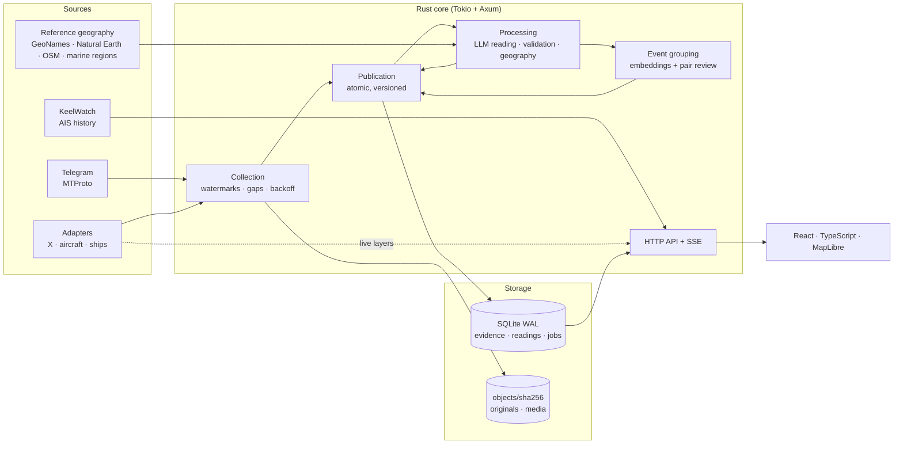

# Architecture

One Rust process, one SQLite database, one folder of content-addressed files,
and a React app it serves. No queue, no search cluster, no microservices.
Everything below exists to keep that small shape fast, correct and honest
under load.

## Flow of one message

1. **Collect.** A source adapter reads a page. The collector stores the exact
   original (bytes in `objects/sha256/`, identity and revision in SQLite)
   before advancing the source's checkpoint. An edit becomes a new revision;
   the old one and any citation to it stay valid.
2. **Publish.** New evidence becomes visible through a *publication*: an
   atomic, numbered version of the workspace. Membership is stored as validity
   intervals over publication numbers, so a new version costs a few rows, not
   a copy, and any old version can still be opened exactly.
3. **Read.** If processing is switched on, the message is sent to the
   evaluated model profile. The reply must be strict JSON against a versioned
   schema. Rust then checks it against the source: quoted passages must exist,
   negations must survive, event counts and places must be supported. A reply
   that fails is held for one audited correction, never published partially.
4. **Place.** Place mentions are resolved against imported reference data:
   GeoNames, Natural Earth, selected boundary editions, marine regions and
   Geofabrik OpenStreetMap extracts. The resolver prefers no answer to a wrong
   one. Ambiguous names, small namesakes abroad and unsupported places stay
   unlocated.
5. **Group.** Claims are embedded, nearby candidates are retrieved, and each
   candidate pair is reviewed by the model into a typed relationship: same
   event, update, denial, correction, distinct or uncertain. Copies of one
   report never count as independent confirmation.
6. **Show.** The browser asks one scope query (time window, area, type) and
   gets the map, list and counts from **the same publication**, so they never
   disagree. Server-sent events tell it when a newer publication exists.

## Decisions and why

**SQLite plus content-addressed files.** One analyst, one machine: an embedded
database with WAL, one bounded writer and a small read pool is faster and far
simpler than a server. Originals are immutable files named by their SHA-256,
written and synced before the database points at them, so a crash can leave
an orphan file but never a record pointing at a missing one. Backup is an
online SQLite backup plus the referenced objects, and restore is tested into
an empty directory.

**Bounded everything.** Every queue has an item limit *and* a byte limit.
Reads go through four workers with a small admission queue, and two separate
workers are reserved for status and Stop, so a heavy import cannot freeze the
controls. Provider pages, media and model responses are size-capped while they
stream.

**Cancellation is real.** Stop prevents new work immediately and cancels the
in-flight request by dropping its future. The test suite proves a stalled
source connection is cancelled within a second while workspace reads keep
answering.

**AI is optional, evaluated and accountable.** Each task has its own pinned
profile: model, provider (no fallback), prompt, schema, reasoning setting and
decoder. A request is recorded before it is sent, and its receipt, including
cost or "unknown cost" if interrupted, is kept. There are no silent retries
that could bill twice, and no quotas that silently drop work. Model output is
never authoritative state: it is a reading of a message, stored separately
from the message itself.

**Honest coverage.** Every layer and list says what it does not know:
unlocated messages are counted, not hidden, a stale aircraft view is labelled
stale, a source gap is recorded as a gap, and a source that is not part of the
build says so.

**The map is a controller, not React state.** MapLibre owns the camera and
layers. React expresses intent and draws panels around it. Live aircraft and
ship positions update map sources directly by feature ID, never by re-rendering
the app.

## Source adapters

Providers implement three traits in
[`app/src/sources.rs`](../app/src/sources.rs): a post timeline, an aircraft
layer and a ship-snapshot layer. The core keeps all the safety rules
(watermarks, gap detection, cursor-repeat detection, backoff). An adapter only
fetches and normalizes. See [SOURCES.md](SOURCES.md).

## Code map

| Path | What it is |
| --- | --- |
| `app/src/server.rs`, `api.rs` | Process startup, HTTP routes, SSE |
| `app/src/collection/` | Source scheduling, catch-up, media, Telegram and timeline collectors |
| `app/src/store*.rs`, `schema.sql` | SQLite schema, publications, evidence and objects |
| `app/src/processing*.rs` | Model reading, validation, correction and receipts |
| `app/src/processing_geo.rs`, `area_*`, `osm*`, `geonames.rs` | Geography resolution and reference imports |
| `app/src/event_*` | Event grouping: embeddings, candidates, pair review |
| `app/src/live_layers.rs` | KeelWatch ships and the aircraft adapter boundary |
| `app/src/vessel_finder*` | Finding ships named in a message |
| `integrations/telegram/` | Telegram adapter on the grammers MTProto client |
| `web/src/` | React app: map, feed, message reader, layers, sources, processing |
| `validation/` | Load generators and contract checks |
| `examples/` | Fictional fixtures for tests and the demo |

Detailed contracts: [API](API_CONTRACT.md), [product specification](SPECIFICATION.md), [event taxonomy](EVENT_TAXONOMY.md).
