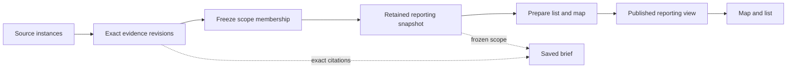

# Fictional first-workflow fixture

`port-investigation.json` is a small, entirely fictional seed for product design and the first end-to-end implementation. It is not production evidence and uses a `demo:` identity namespace. The positions are illustrative, not claims about actual facilities or movements. It contains no account or source credentials.

Use it to demonstrate these behaviors without network access or AI:

- Two reports repeat one originating account, so they cannot create two independent confirmations.
- A later official statement narrows the original allegation; source publication time and workspace acquisition time differ.
- A source edit must preserve its previous revision and exact saved citations.
- A report with unresolved geography remains readable and useful.
- A vessel track has an explicit observation gap; a nearby thermal observation does not establish an attack.
- A saved brief pins evidence revisions, scope and cutoff, then can be reopened after later evidence arrives.

The file includes sources, evidence revisions, simple observations, an investigation, a watch draft, a baseline brief and expected assertions. It is a semantic fixture, not a mandatory database schema. Each implementation may map it to its own model while preserving IDs, provenance and meanings.

The saved brief includes its scope revision and frozen reporting membership. Its interval uses publication time; it does not invent an event time from a post timestamp. The first release can reopen this fixed snapshot without implementing arbitrary known-at-the-time reconstruction. Later replay work must reproduce the same membership from acquisition times. Vessel and thermal observations remain separately attributed context.

Import order: register demo sources; preserve evidence revisions and observations; create the investigation and its pinned references; save the baseline brief; evaluate the later updates. Keep demo and real data visibly separate. A fixed replay view makes the historical sample usable regardless of today's date.

This small fixture covers a subset of the specification. It does not replace the 50 acceptance scenarios, broader AI evaluations or the dense-data performance fixture. Add targeted synthetic cases as features arrive; do not copy the owner's real archive into tests.

## Visual lineage fixture

`lineage_example` provides fictional expected nodes, typed edges and a record-level trace for the existing baseline. It is a semantic design seed, not a claim that a recipe was executed or a mandated database schema. Its three retained reporting revisions produce a list with three entries and a map with one placed report; two reports remain unlocated. The saved brief retains direct citation edges to its two supporting revisions.



The UI should let the analyst click any step, inspect input/output counts and examples, and follow a selected record upstream or downstream. The repeated-report relation is labeled separately from derivation and citation. Pair this happy-path fixture with A30/A34's multiplication, exclusions, failed candidate and historical-revision checks. Expanding the graph cannot run a recipe or spend model credits.


For the explicit local-media browser check, `app/examples/ui_media_fixture.rs` reuses the fictional Port Selene bundle with one synthetic transparent PNG attachment and a paused synthetic source policy. Run it only into a new temporary directory. No credentials, account connection or provider request is used; the image is served from an exact retained revision by the same media API as live evidence.

## Message-processing evaluation

`processing-evaluation.json` contains 24 invented English, Hebrew, Persian and Arabic messages: 15 development cases and nine holdout cases. It records expected kind, claim status, topic, critical facts/negation and conservative location outcomes. Three explicitly resolver-only cases intentionally model an invalid extraction, such as a quote absent from the message or a conflicting canonical name; these must abstain instead of assigning a point. The other 21 cases are eligible for semantic model evaluation (13 development, eight holdout); check each case's `evaluation_targets`. Copies never become independent confirmation. The fixture is not importable production evidence or a model-quality claim. `cargo test --manifest-path app/Cargo.toml processing_geo --lib` exercises its deterministic geography expectations against the separately accepted publisher reference.

## Message processing fixtures

`processing-ai.json` contains authored translation/extraction gold cases, including held-out multilingual, denial, historical, correction and injection cases. Gold outputs are fixtures, not a claim about model performance. `processing-evaluation.json` adds 24 geographic task cases with roles, ambiguous/unsupported proposals, copied reporting and expected abstention. None is real intelligence.

`app/examples/ui_processing_fixture.rs` validates gold outputs, resolves supported place mentions and publishes them into a new temporary fictional workspace for actual-interface checks. It makes no model or source calls. `app/examples/evaluate_processing.rs` is the separate bounded live-model evaluation; use an isolated data directory and explicit private configuration. Keep actual response audits private, and report aggregate pass/fail, provider usage and costs without credentials.

## Current visibility-first UI acceptance

`viewer-acceptance.json` defines the simplified map/message journey against `ui_processing_fixture`: one readable message, Original and exact support on demand, compact provenance and no manual-investigation navigation. Existing investigation fixtures remain storage/history regression fixtures; they no longer define the main interface.

`telegram-media-recovery.json` supplies fictional adapter-shaped data for the application media regression tests. It covers equal timestamps with different RFC3339 formatting, rotating file references/counters, genuine edits, old-publication preservation, paused/catching-up source state, invalid origins, cancellation and immutable asset associations. It is an offline test input, not a live import bundle.


## Event classification and browsing

`processing-events.json` contains 21 owned fictional event cases covering all eleven types, native Arabic/Hebrew/Persian, plans/denials/history, bare questions versus explicitly unverified reports, independent event sites and speaker locations. `processing-ai.json` now adds event annotations to its eight existing semantic cases; no-injury/unknown-cause attributes and civilian travel are explicit negative controls. The combined model gate uses 29 cases, at most 29 calls per new isolated run, a $0.50 admission stop and unchanged private audits. Test fixtures are never prompt examples. Offline replay validates retained responses without rebilling. See validation/EVENTS.md for failed trials as well as the final gate; a gold fixture alone is not model performance.

Reproduce the interface fixture without any source or model calls:

```sh
cargo run --manifest-path app/Cargo.toml --locked --example seed_events -- --root . --data-dir data/events-ui-new --port 8795
./app/target/release/relic-app --root . --data-dir data/events-ui-new --port 8795
```

The seed requires a new directory. It imports 21 fictional originals and publishes their validated authored interpretations. Events has 15 message members, Strike has three, All + Protest has two (one planned), Events + Protest has one, and All + Armed attack has two messages but only one map point. A denial never inherits the mixed message's different strike point. All messages retains all 21 originals. Use a fresh browser context for the fixture; never merge it into `data/live`.

## Expanded event and geographic fixtures

`processing-taxonomy.json` adds 18 authored event cases derived from vocabulary review, with planned evacuation/meeting distinctions. Combined with the existing event fixture, `seed_events` creates 39 fictional messages (31 reported Events) without provider/model requests. The expanded model evaluator contains 47 cases and has not been run/promoted yet. `app/src/geonames.rs` tests use entirely fictional tab-separated geographic records for multilingual aliases, homonyms, historical aliases, broad areas, mismatched countries, corruption, failed refresh and cancellation. Real GeoNames geography is reference data, retained separately from these fixtures and from live evidence.


## Multi-site messages

`processing-multisite.json` adds four authored, fictional cases: different event types in two cities, two types in one city, a known city plus an unresolved second site, and a planned event with an independent source geotag across the antimeridian. `seed_events` includes these alongside the 41 existing event/taxonomy cases (45 total), in a new isolated workspace with no provider or model calls. Rust tests check type/bbox/source/time predicates, exact originals, publication history and restored site identity.

`cargo run --release --locked --manifest-path app/Cargo.toml --example benchmark_multisite` creates a disposable 10,000-message/20,000-site workspace using the normal bounded import and processing-publication paths. It checks complete message/timeline counts, the 10,000-site draw cap and page links beyond that cap under all/type/bbox scopes. An optional explicit directory argument reuses only that owned fictional seed; no environment credentials are loaded.

Area acceptance uses `processing-areas.json`: four authored fictional reports and synthetic country/province geometry, including an analytical hole deliberately absent from the display shape. The fixture proves filtering uses full geometry and that denial/issuer context never becomes an occurrence. It is not geographic truth. `cargo run --release --locked --manifest-path app/Cargo.toml --example seed_areas -- --root . --data-dir data/NEW-area-qa --port 8794` creates a new isolated offline UI workspace; an existing database is rejected. No provider/model calls occur.


`media-continuations.json` is a separate fictional Telegram-shaped bundle: a captioned post, image follow-ups at 1:00 and 2:59, an excluded 3:01 image, and a later distinct report. `app/examples/ui_media_continuations.rs` imports it into a new isolated directory and caches one tiny synthetic image for provider-free UI verification. Never import this into the live workspace. Integration tests additionally cover native albums/replies, other authors/sources, empty acquired text, edits, exact revisions and historical publications.

## Additional reading checks

`processing-reading-acceptance.json` adds 12 fictional multilingual cases: denial, planned and historical claims, casualty qualifications, issuer versus event site, ordinary civilian travel and an unnamed site. These cases were authored after the initial prompt experiments and subsequently used in v11 development; do not present them as independent population accuracy. v1.1 explicitly accepts the future headline wording “teachers to travel” while requiring the complete translation and no invented event. Every saved-response replay still verifies byte-identical source and response hashes.


`processing-reading-continuation.json` contains eight fictional citation-context, ambiguous-type, denial and bilingual development regressions. Broad v12 candidates did not preserve the existing gates and are not production settings. Its v1.1 gold review restores the explicit duration phrase “after 2 hours”; source/claim/type/negation criteria are unchanged. The failed candidate prompt is archived under `validation/reading-continuation-candidate.txt`.

`processing-reading-mixed.json` contains five fictional cases for the narrowly scoped bilingual request branch: equivalent content, additional injuries/cause uncertainty, denial, a plan not begun, and malicious instructions retained as source text only. Select it with `RELIC_EVALUATION_SUITE=mixed`; select the broader unpromoted set with `RELIC_EVALUATION_SUITE=continuation`. All evaluation workspaces remain isolated from live evidence. The production review combines five fresh bilingual results with 61 unchanged-request replays; it is not unseen population accuracy.

`processing-reading-long.json` is a 14,010-character fictional Portuguese translation stress case, selected with `RELIC_EVALUATION_SUITE=long`. It checks a complete reading through the final numbered paragraph, preserved quantities/negation, and one occurrence despite repeated background context. This tests response headroom, not unseen accuracy. The Luna review also accepts “not a demonstration from today” as equivalent to “not a protest from today”; an automated negative control still rejects removal of the today negation.

Marine acceptance is authored directly in `app/tests/marine.rs`: deliberately
fictional rectangles/holes under the selected product's identity contract, never
real geographic truth. It verifies multilingual exact names, contextual/denied
non-occurrence, no centroid, full-geometry scope, historical publications, corrupt
release rollback, restore and reference-only fresh-workspace copy. The live public
publisher payloads stay outside the fictional fixture and outside Git.

## Fictional OSM facilities

`osm-facilities.osm` and its ordinary/public-dense PBF companions are authored
fictional fixtures, not downloaded geography. They cover supporting untagged nodes,
an airport point, a hospital multipolygon with a hole, a deliberately closed linear
rail feature, an energy polygon, missing nodes and unsupported relation members.
The public-dense variant omits contributor fields while retaining version/time.
`app/tests/osm.rs` exercises activation, exact-name/country rules, overlapping
snapshot provenance, map/feed scope and backup/restore without provider calls.
An explicit `RELIC_KEEP_OSM_FIXTURE=1` test run retains an isolated fictional
workspace for interface QA; it never imports test messages into live data.

## Fictional event relationships

`event-link-evaluation.json` contains 40 authored pairs: the 20 earlier embedding
cases plus 20 challenge cases covering directional/numbered facilities, distinct
repeat attacks, denial, correction, updates, generic copying, untrusted source
instructions and Arabic negation. These are development examples, not an unseen
population benchmark. Ten pairs are rejected by local context rules before a call.

`event-link-responses.json` retains the exact decision content and relevant protocol
fields from the 30 Luna replies, with request and full private raw-response hashes.
It omits unrelated provider-envelope fields. The Rust offline regression checks the
request hashes, strict decoding, exact supporting passages and link membership.
One `distinct` expectation produced a safe `uncertain`; strict evaluation remains
failed at 39/40. Full private receipts can also be replayed with the evaluation
command without new provider calls. No live evidence was sent for this benchmark.

## Reading decoder and ship finder evaluations (9 October 2026)

`processing-reading-decoder.json` holds 16 fictional model replies decoded offline
(no requests): styled letters, non-breaking hyphens, curly outer quotes, a Hebrew
article and Persian letter variants, each with accepted and rejected forms.
`evaluate_processing` checks them before any request and on every replay.

`vessel-mentions-evaluation.json` holds 40 fictional ship-finder cases in English,
Arabic, Persian, Hebrew and Russian (28 naming 34 ships, 12 naming none) with
explicit pass thresholds. `app/examples/evaluate_vessels.rs` runs them against the
pinned profile with retained replies, or replays retained replies with zero calls.
All names, identifiers and texts are invented.


## README demo workspace

`demo-workspace.json` holds 30 invented reports used for the README video and
screenshots. No person, organisation or incident in it is real; only the cities
are, so the public Natural Earth reference can place them. Readings are authored
and pass the same exact-support validation and geography as model output. Three
are in Arabic, Persian and Hebrew with English translations, and three stay
unlocated on purpose: two name no place, and "Djibouti" is both a city and a
country, so the resolver does not guess.

```sh
cargo run --manifest-path app/Cargo.toml --release --example demo_workspace -- data/demo
./relic --data-dir "$PWD/data/demo"
```
